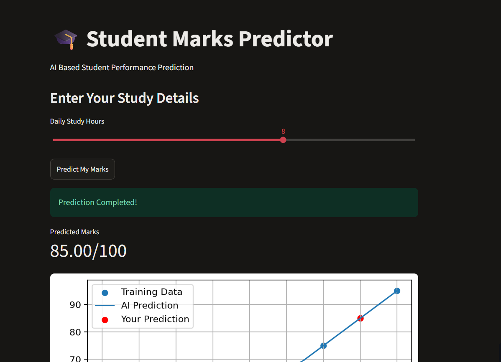

# 🎓 Student Marks Predictor

An AI-based machine learning web application that predicts student marks based on daily study hours.

## 🚀 Live Demo
👉 **[Click here to try the Live App](https://student-mark-predictor-9z8yes5jr8yftc7khpq3wz.streamlit.app/)**

## 📸 Project Screenshot

## 🛠️ Technologies Used
* **Python**
* **Streamlit** (Web Interface)
* **Scikit-Learn** (Machine Learning Model)
* **Pandas & NumPy** (Data Processing)
* **Matplotlib** (Data Visualization)
*
